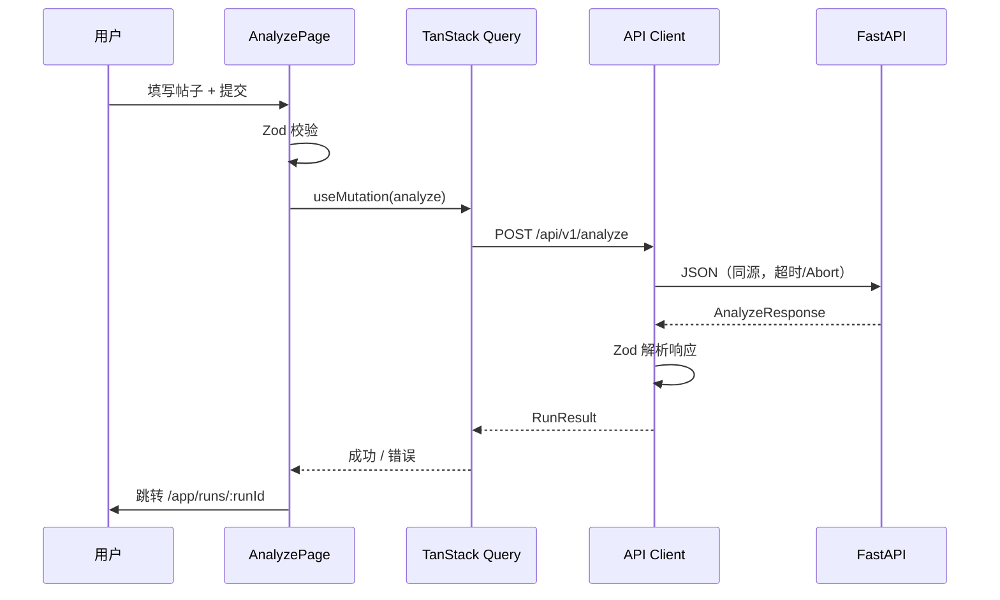

# 隐性广告识别 · 前端网页架构（首版）

> 状态：首版 SPA 已按本设计实现；配套图：[implicit_ad_web_frontend.html](implicit_ad_web_frontend.html)。
> 参考站点：EchoBreak（`http://101.35.88.149:1453/`，React + Vite 多页壳）。只参考信息架构与视觉语言，不复制其社区、管理后台、登录体系和知乎抓取。

## 1. 范围

- 交付形态是**本机网页端**，浏览器插件是后续冲刺项。
- 首版只做隐性广告分析闭环：录入 → 运行 → 看结论/证据 → 恢复一次运行 → 批量/URL 导入。
- 不引入账号、社区、管理员、公开分享、云端存储。
- 现有 `implicit-ad-agent` 的 `/workbench` 保持不动；新前端挂在 `/app`，稳定后再决定是否替换。
- 人工标注工作台（`data-tooling/annotation/html_annotator.py`）是内部工具，不并入本产品前端。

## 2. 技术栈与部署

建议：

- React 19 + TypeScript + Vite
- React Router（浏览器路由）
- TanStack Query（服务端状态、缓存、重试）
- Zod（运行时校验 API 响应）
- ECharts（证据覆盖、时间线等图表）
- 原生 CSS 变量 + 轻量组件样式，不引入重型 UI 框架

首版实现使用上述 React/Vite/TypeScript、React Router、TanStack Query 和 Zod。
证据覆盖先用轻量 CSS 可视化，复杂 ECharts 图表按真实评估需求后置。

构建产物放到 `implicit-ad-agent/impad/web/app/`，由 FastAPI 同源提供：

- `GET /app` → `index.html`
- `GET /app/assets/*` → 静态资源
- 其余 `/app/*` → 回退 `index.html`（SPA history fallback）
- 运行时**不需要 Node**；Node 只在开发/构建时使用。

如果不想引入前端构建链，可以退回 ES modules + 原生组件，但组件边界和 API 契约保持不变；不建议首版同时维护两套实现。

## 3. 信息架构

| 路由 | 页面 | 说明 |
|---|---|---|
| `/app` | 重定向 | 跳到 `/app/analyze` |
| `/app/analyze` | 单条分析 | 默认页；文本/图片/评论/历史输入，提交后进入报告 |
| `/app/batch` | 批量分析 | JSON 数组或 CSV 粘贴，最多 50 条，显示逐条成功/失败 |
| `/app/import` | URL 导入 | 先 preview，人工修正后 confirm；不直接抓取正文 |
| `/app/runs/:runId` | 运行报告 | 结论、置信度、证据链、披露、创作者历史、法规引用、Agent 轨迹 |
| `/app/history` | 最近运行 | 只存 localStorage 的 run_id 与摘要，不存正文 |
| `/app/settings` | 能力与健康 | `/health`、`/capabilities`、模型/检索/批量上限 |

导航顺序：单条分析、批量、URL 导入、最近运行、设置。顶部只保留：本机模式、API 健康、当前 run 状态。

## 4. 页面骨架

```
┌────────────────────────────────────────────────────────────┐
│ 顶栏：产品名 / 本机 127.0.0.1 / API 状态 / 当前 run 胶囊   │
├──────────────┬─────────────────────────────────────────────┤
│ 左侧导航      │ 主区：页面标题 + 操作区                     │
│ 单条分析      │ ┌─────────────────────────────────────────┐ │
│ 批量分析      │ │ 输入卡 / 报告头卡                        │ │
│ URL 导入      │ ├─────────────────────────────────────────┤ │
│ 最近运行      │ │ 证据链主卡                              │ │
│ 设置          │ │  ┌──────────────┐  ┌────────────────┐  │ │
│              │ │  │ 证据画布      │  │ 结论/置信度     │  │ │
│              │ │  └──────────────┘  └────────────────┘  │ │
│              │ ├─────────────────────────────────────────┤ │
│              │ │ 时间线 / 法规 / Agent 轨迹（按需展开）   │ │
│              │ └─────────────────────────────────────────┘ │
└──────────────┴─────────────────────────────────────────────┘
```

视觉语言参考 EchoBreak：浅蓝到淡紫的柔和渐变、半透明卡片、圆角、细边框、左侧固定导航、顶部状态胶囊。风险用红色强调，缺失/未采集用琥珀色，成功/已保存用绿色。不要使用大面积深色或装饰性噪声压过证据文本。

## 5. 组件边界

| 组件 | 职责 | 明确不做什么 |
|---|---|---|
| `AppShell` | 导航、顶栏、错误边界、全局 toast | 不持有业务数据 |
| `AnalyzeForm` | 单条输入、字段校验、采集完整性开关 | 不直接发请求 |
| `BatchEditor` | JSON/CSV 解析、逐条校验、50 条上限 | 不把失败项静默丢弃 |
| `UrlImportWizard` | preview → 人工修正 → confirm | 不绕过 preview 直接分析 |
| `RunReport` | 组合报告各区块 | 不重新计算结论 |
| `VerdictCard` | 标签、置信度、需复核提示 | 不把模型输出伪装成人工结论 |
| `EvidenceCanvas` | 证据码 D/C/P/A/V/M/B 与证据条目 | 不隐藏缺失证据 |
| `DisclosurePanel` | 披露区域 present/absent/missing/unknown | 不把“未采集”写成“未发现” |
| `CreatorShiftTimeline` | 创作者历史窗口、变化点、历史基线 | 不推断缺失历史 |
| `LegalBasisPanel` | 法规/指南引用与版本 | 不生成无出处的法条 |
| `AgentTracePanel` | 运行步骤、工具调用、耗时 | 不展示模型内部思维链 |
| `RunMetaPanel` | run_id、模型、版本、时间、导出 | 不只显示“成功”而无来源 |
| `EvidenceChart` | 证据覆盖/置信度可视化 | 不用图表替代原始证据 |
| `AsyncState` | loading / empty / error / stale | 不把错误渲染成空结果 |

## 6. 数据契约（复用现有 `/api/v1`）

首版不新增 SSE 或异步队列；分析是同步请求，前端显示后端真实耗时，不伪造进度。
单条分析、批量输入、URL 预览/确认、运行报告、最近运行和能力设置均已接入现有 API。

| 方法 | 路径 | 用途 |
|---|---|---|
| `GET` | `/health` | 进程健康 |
| `GET` | `/api/v1/capabilities` | 标签、运行时、批量上限、URL 平台、检索能力 |
| `POST` | `/api/v1/analyze` | 单条分析，返回完整报告 |
| `POST` | `/api/v1/analyze/batch` | 批量分析，逐条 ok/error |
| `POST` | `/api/v1/import/url/preview` | 生成 preview_id 与可修正字段 |
| `POST` | `/api/v1/import/url/confirm` | 带 corrections 确认并分析 |
| `GET` | `/api/v1/runs/{run_id}` | 按 run_id 恢复报告 |

`AnalyzeRequest` 关键字段：

```ts
type AnalyzeRequest = {
  text: string;
  post_id?: string;
  platform?: string;          // 默认 "other"
  blogger?: string;           // 默认 "未知"
  creator_id?: string;
  published_at?: string;
  image_url?: string;
  image_path?: string;        // 仅服务端允许的本机路径
  comments?: unknown[];
  history?: unknown[];
  capture_complete?: boolean; // 默认 false
  runtime_mode?: "local" | "mcp";
};
```

`AnalyzeResponse` 关键字段：`verdict_report`、`evidence_bundle`、`run_metadata`、`run_events`、`readable_report`。前端只读这些结果，不在客户端重算标签或置信度。

`GET /capabilities` 当前返回标签 `["明广","暗广","非广","需复核"]`，与论文/标注指南中的 `uncertain` 是同一语义的不同展示名；UI 统一显示“需复核”，导出/日志保留后端原值。

## 7. 请求与状态流



状态归属：

- 服务端状态：TanStack Query，key 为 `["capabilities"]`、`["run", runId]`；不把报告复制进全局 store。
- URL 状态：当前 run、tab、筛选放 URL，刷新可恢复。
- 本地 UI 状态：表单草稿、折叠面板；不持久化正文。
- 最近运行：localStorage 只存 `{run_id, post_id, label, confidence, created_at}`，上限 20 条；清空入口放在设置页。

## 8. 错误、缺失与安全边界

- API 502/503、超时、JSON 解析失败：显示红色错误卡与可重试按钮；**不显示示例分数、不关键词回退、不自动保存**。
- 已有报告时请求失败：保留 last-good，并标注“本次刷新失败，显示上次结果”；不覆盖旧证据。
- 缺图片/视频/披露/评论：分别显示“缺失 / 未采集 / 不可读”，不能显示为“未发现”。
- 所有用户文本用 `textContent` 或 React 默认转义；禁止 `innerHTML` 渲染帖子/评论/模型输出。
- 媒体只通过同源代理或受控静态路径加载；`image_path` 不允许任意本机路径，首版建议只接受服务端白名单目录或上传到临时目录。
- 仅监听 `127.0.0.1`；不引入外部 CDN、埋点、字体服务；CSP 保持 `default-src 'self'`。
- 不把真实帖文/评论发到外部服务；本地 Ollama 地址必须是 loopback。
- 无登录不等于无边界：页面明确标注“本机单用户”，不要部署到公网。

## 9. 首版实现范围与后续顺序

1. 已完成：`implicit-ad-agent/web/` React + TypeScript + Vite 工程，构建到 `impad/web/app/`。
2. 已完成：FastAPI 同源静态资源和 SPA 路由回退；`/workbench` 保持不变。
3. 已完成：API Client、Zod 响应校验和 TanStack Query 服务端状态管理。
4. 已完成：单条分析、批量分析、URL preview → confirm、报告恢复、最近运行和能力设置。
5. 已完成：报告只读展示判定、披露、证据覆盖/条目、CreatorShift、法规引用、Agent 事件和运行元数据。
6. 已完成：失败提示、报告缓存、last-good 展示、JSON 导出与本地历史摘要。
7. 暂缓：媒体上传/路径输入及代理、复杂 ECharts 图表、异步队列、取消长时间分析。URL 页按 `/capabilities` 适配器清单启用；尚无已注册适配器时明确禁用预览。
8. 下一步：配置并验收受控的平台 URL 适配器，再按真实使用反馈补字段；先独立评估，不直接替换 `/workbench`。

## 10. 待确认

- 是否接受引入 Node/Vite 构建链；若不接受，改用 ES modules，但组件边界不变。
- 报告页是否需要导出 PDF；首版先做 JSON 下载和打印样式。
- 批量页是否需要断点续跑；当前 API 是同步批量，首版只做逐条失败重试。
- `image_path` 的允许目录与上传策略；在确认前只支持 `image_url` 和演示用本地样例。
- 后端是否补 `GET /api/v1/runs` 列表；未补前“最近运行”只来自 localStorage。
